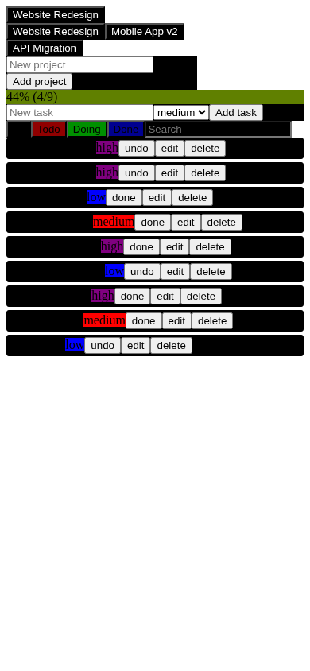

# TinyCoder Weight Lab

**Researching how far a 0.5B-parameter coding model can go toward reliable full-stack development.**

This project experiments with [Qwen2.5-Coder-0.5B](https://huggingface.co/Qwen/Qwen2.5-Coder-0.5B), direct weight-space interventions, execution-guided generation, and a small-model coding-agent architecture. Our long-term goal is a model and development system that can plan, write, test, debug, and refine complete applications—not just produce convincing-looking code snippets.

> **Current status — functional application milestone, not frontier-model parity.** The frozen 0.5B model produced the application-specific code for **TaskFlow**, a working project/task manager, using tightly staged generation, public-test feedback, and trusted infrastructure. Its Playwright browser run passed **15/15 interaction steps**. The result demonstrates an *assisted system*, not independent one-shot full-stack generation or a permanent increase in Qwen's abilities.

## See what Qwen built: TaskFlow V1


<details>
<summary>View the real mobile screenshot (390 × 844)</summary>



</details>

These are **real Playwright screenshots from a running React + Express application**, captured with synthetic data—not AI-generated concept art. **V1 is functional but visually unfinished.** Its cramped controls, weak hierarchy, spacing, and mobile presentation are targets for the next iteration. No production deployment is claimed.

**Explore:** [TaskFlow application source](apps/taskflow-qwen/) · [Detailed Session 033 report](docs/ZAI_AUTONOMOUS_FULLSTACK.md) · [Browser-test evidence](experiments/zai-taskflow/reports/browser_test.json) · [Source provenance](apps/taskflow-qwen/ORIGIN.json) · [GitHub Actions workflow](.github/workflows/session033-zai-autonomous-fullstack.yml)

### Measured milestone

| Verification | Result | What it means |
| --- | ---: | --- |
| Real browser interactions | **15/15** | Create/select projects, create/edit/filter/search/delete tasks, update progress, refresh, and verify persistence |
| Public module checks | **82/82** | Checks across Python logic, Node store, Express API, React UI, and CSS |
| Frozen holdout, Python logic | **2/2** | Held-out logic cases, not used to choose the final candidate |
| Frozen holdout, Node store | **11/11** | Independent store checks |
| Frozen holdout, Express API | **8/8** | Independent route checks |
| Final application modules parsing | **5/5** | All selected role modules are syntactically valid |
| Qwen-authored application-specific code | **676 lines** | Model-written selected code across five modules, excluding trusted scaffolding |

The five role modules were Python progress logic, a persistent Node store, Express routes, React UI, and CSS. The build, server wiring, bridge, fixed public-contract anchors, piece-assembly rules, and evaluation harness were **trusted scaffolding**. The archived lineage ties selected source to actual Qwen generations; a supervising system searched, tested, selected, and guided local repairs.

The final experiment recorded **593 generations, 269,058 output tokens, and approximately 10.7 hours of generation time** on a 2-CPU setup. These costs matter: **15/15 is an end-to-end result for a heavily assisted build, not native model `pass@1`.** See the [full experiment report](docs/ZAI_AUTONOMOUS_FULLSTACK.md) for public/holdout separation, model attribution, limitations, and reproduction details.

## The research tracks

| Track | What we are testing | Evidence so far |
| --- | --- | --- |
| **Direct weight-space programming** | Reversible, algebraically computed changes to model matrices, without gradients or LoRA | Real tensor interventions are possible, but **no repeatable general full-stack skill gain has been established** |
| **Execution-guided code generation** | Small code segments, public checks, error feedback, bounded retries, and deterministic assembly | **TaskFlow works in a real browser** under this assisted process |
| **Learning from corrections** | Whether diagnosed errors help Qwen avoid analogous failures | Browser-feedback repairs helped TaskFlow; an initial independent-domain transfer test showed **no measurable benefit** |
| **Independent application generation** | Whether the process carries over to new products rather than one carefully solved app | **Next evaluation**, not yet demonstrated by TaskFlow |

### Why the distinction matters

- **Native model capability:** what unchanged Qwen produces from a fresh prompt, without scaffold or test-time search.
- **Agent-system capability:** what the same Qwen can accomplish with decomposition, examples, multiple samples, tests, feedback, and supplied integration code.
- **Permanent model improvement:** a reproducible better result on *unseen tasks* when only model weights change. We **have not demonstrated this for full-stack development**.

Our research reports track these separately. A polished interface by itself will not count as evidence that the model's neurons learned a transferable programming skill.

## Milestones and next steps

| Phase | Status | Goal / result |
| --- | --- | --- |
| Early tensor-edit and coding benchmarks | <code>Completed experiments</code> | Established baselines, bounded edits, and negative as well as positive results |
| Small cross-language application slices | <code>Completed experiments</code> | Tested Python + Express + React integration under different scaffolds |
| **TaskFlow V1 (Session 033)** | **Milestone achieved** | 15/15 real browser steps with full source lineage |
| **TaskFlow V2 visual quality** | **Planned** | Strong design system, modern layout, accessible controls, responsive desktop/tablet/mobile behavior, while retaining tests |
| **MediVault Lite independent application** | **Planned** | New document-management domain; measure whether staged generation genuinely transfers |
| **Model-native full-stack competence** | **Long-term research** | Larger, unseen task suites, independent debugging, and honest before/after weight-edit evaluation |

The next visual/intelligence study will compare the unchanged baseline against increasingly assisted generation on **a second application**. It should preserve all source-attribution records, full test evidence, execution budgets, and real application screenshots. Planned milestones are not presented as finished work.

## Evidence, history, and reproducibility

- **[Session 033 technical report](docs/ZAI_AUTONOMOUS_FULLSTACK.md):** exact module results, provenance, 593-attempt budget, browser repair record, independent transfer result, and weight-space limitations.
- **[TaskFlow source provenance](apps/taskflow-qwen/ORIGIN.json):** module-level Qwen-versus-scaffold attribution.
- **[TaskFlow browser run](experiments/zai-taskflow/reports/browser_test.json):** machine-readable step outcomes; see also the [frozen holdout report](experiments/zai-taskflow/reports/holdout_evaluation.json).
- **[Architectural-circuits report](docs/ZAI_ARCHITECTURAL_CIRCUITS.md):** causal probes and bounded weight edits, including failures to generalize.
- **[Full historical README](README_RESEARCH_ARCHIVE.md):** earlier sessions, setup commands, benchmark tables, and experiment notes, preserved rather than deleted.
- **[Agent and safety protocol](AGENTS.md):** experiment boundaries and attribution standards.

The TaskFlow report documents how to reproduce its build and browser checks in an appropriate isolated environment. **Treat all model-generated code as untrusted**: do not execute archived candidates on your normal machine. The project uses restricted evaluators and local-only (`127.0.0.1`) browser testing; a source repository or screenshot is not a permanently hosted live application.

## Get started with the research code

For the general experiment framework on Windows PowerShell:

```powershell
git clone https://github.com/7clan/ai-wieght-optimiization.git
cd ai-wieght-optimiization
py -m venv .venv
.venv\Scripts\Activate.ps1
python -m pip install -r requirements.txt
python -m unittest discover -s tests -v
python -m tinycoder train --dry-run
```

The `train --dry-run` command is a configuration check, **not a training run**. The older LoRA experiment is archived; the active weight-space track does not train or fine-tune parameters. Consult the [historical guide](README_RESEARCH_ARCHIVE.md) and [repository agent instructions](AGENTS.md) before running specific experiments. The full pretrained model checkpoints are not committed to this repository.

## What success would look like

The goal is not merely to produce a screenshot that resembles a modern app. Success means a small coding model can **reliably build and debug previously unseen full-stack applications**, with transparent assistance costs—and that any claimed *model improvement* survives separate, frozen evaluations. TaskFlow V1 is our clearest working milestone so far, and a starting point for that more demanding test.
